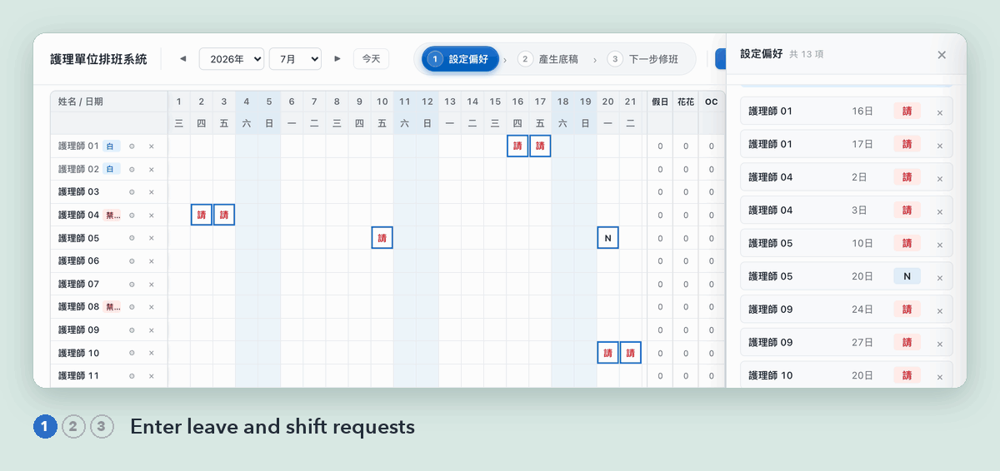

<div align="center">

# StaffRoster

**Constraint-based monthly shift scheduling for hospital nursing units.**
Draft a roster in seconds, repair it with CP-SAT, and find out *why* when no valid roster exists.


**English** · [繁體中文](README.zh-TW.md)



</div>

## Highlights

- **Two-stage scheduling.** A rotation heuristic lays out a draft instantly. Then a CP-SAT model repairs it into a fully valid roster while changing as few cells as possible.
- **Explains infeasibility.** When the requests make a valid roster impossible, the solver returns the specific rules that conflict (who, which day, which rule) instead of a bare "no solution".
- **Best-effort fallback.** A relaxed solve gives up low-priority rules first, by penalty weight, and reports exactly what it gave up.
- **Real-world rules.** Taiwan labor-law rest quotas, shift-transition rules, daily coverage, fixed-shift staff, leave and preferences.
- **Rules live in settings, not code.** Shift types, daily staffing needs (weekday / Saturday / Sunday / holiday) and "after shift X, the next day can only be Y" transition rules are edited in a settings panel. Fixed and forbidden shifts are set per nurse. The live validator and the CP-SAT model read the same config, so a new rule takes effect without code changes.
- **Ships to non-developers.** GitHub Actions builds a one-click Windows app on every release tag.

> Built for a nursing unit in Taiwan. All staff names in this repo are placeholders.

## How it works

**Leave & preferences → rotation draft → CP-SAT repair → manual tweaks → Excel export.** If the repair is infeasible, the app runs a conflict diagnosis and offers a relaxed solve.

| | |
|---|---|
| **Hard rules** | forbidden shifts · locked requests · holiday rotation · monthly rest / day-off / national-holiday quotas |
| **Soft rules** (penalty) | daily coverage (1000) · shift transitions (300) · daily leave limits (300) · ≤ 6 consecutive days (200) · weekly quota balance (100/50) |
| **Objective** | minimise changes to the draft · grant weekday leave · spread N/E shifts across staff |

A single `ConstraintRegistry` builds every rule in one of three modes: plain `hard` constraints, `assumption` literals for diagnosis, or weighted `slack` variables for the relaxed solve. All three solver paths share one set of rule definitions. See [`server/solver.py`](server/solver.py).

## Quick start

**Windows:** download `StaffRoster-windows.zip` from [Releases](../../releases), unzip it, and run `StaffRoster.exe`.

**From source:**

```bash
pip install -r server/requirements.txt
python3 launcher.py               # UI + API on http://127.0.0.1:8000
```

**Regression test** (a full month with leave and preferences; run it while the server is up):

```bash
cd server && python3 test_july.py
```

## Tech stack

| Layer | |
|---|---|
| Frontend | Vanilla JS, CSS Grid, no build step, `localStorage` persistence, `xlsx-js-style` export |
| Backend | Python, FastAPI, Pydantic |
| Solver | Google OR-Tools CP-SAT |
| Packaging | PyInstaller + GitHub Actions |

<details>
<summary><b>Project structure</b></summary>

```text
js/scheduler.js       rotation draft generator
js/validator.js       client-side rule checker
js/shift-config.js    configurable shift types & rules
js/app.js             UI and workflow
js/export.js          Excel export
server/solver.py      CP-SAT model (hard / assumption / slack)
server/rules.py       shift logic, weekly quota targets
server/main.py        FastAPI: /api/repair, /api/repair/relaxed
launcher.py           desktop launcher (PyInstaller entry)
```

</details>
