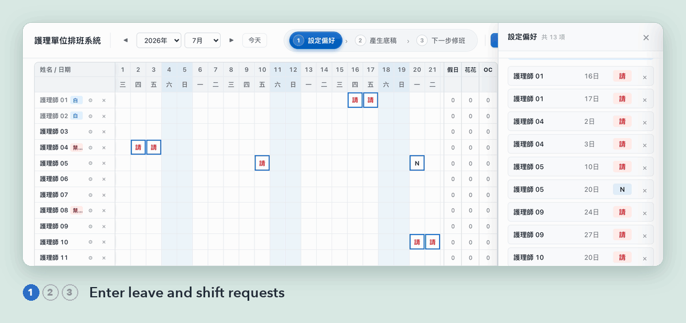

<div align="center">

# StaffRoster

**以限制式最佳化排出護理單位的月班表。**
幾秒產生底稿，交給 CP-SAT 修班；排不出來時，告訴你*為什麼*。


[English](README.md) · **繁體中文**



</div>

## 特色

- **兩階段排班。** 先用輪轉規則立即鋪出底稿，再由 CP-SAT 模型在盡量少改底稿的前提下，修成完全合法的班表。
- **說明為什麼無解。** 當請假與偏好讓班表不可能成立時，求解器會指出互相衝突的具體規則（誰、哪一天、哪一條），不會只回一句「無解」。
- **退而求其次的鬆弛解。** 依懲罰權重先犧牲優先度較低的規則，強制排出班表，並列出確切犧牲了哪些規則。
- **真實的排班規則。** 勞基法的休／例／國配額、接班規則、每日班別人力、固定班人員、請假與偏好。
- **規則寫在設定裡，不寫死在程式裡。** 班別、每日需要的人力（平日／週六／週日／國定假日分開設定），以及「上完 X 班，隔天只能排 Y」的接班規則，都能在設定面板中編輯；固定班與禁忌班則可針對每位護理師設定。前端的即時檢查與 CP-SAT 模型讀的是同一份設定，新增規則不必改程式。
- **一般使用者也能直接用。** 每次發布新版本，GitHub Actions 都會自動打包成點兩下就能執行的 Windows 程式。

> 為台灣一個護理單位打造。本 repo 中的人員名稱皆為代稱。

## 運作方式

**請假與偏好 → 輪轉底稿 → CP-SAT 修班 → 手動微調 → 匯出 Excel。** 若修班無解，系統會進行衝突診斷，並提供鬆弛解。

| | |
|---|---|
| **硬性規則** | 禁忌班 · 使用者指定的請假與偏好 · 假日輪值 · 每月休／例／國配額 |
| **軟性規則**（懲罰權重） | 每日班別人力（1000）· 接班規則（300）· 每日請假上限（300）· 連續上班不超過 6 天（200）· 每週配額平衡（100／50） |
| **最佳化目標** | 盡量少改底稿 · 盡量准平日請假 · 讓 N／E 班平均分配給每個人 |

所有規則都由同一個 `ConstraintRegistry` 建立，並可切換三種模式：一般求解用的 `hard` 限制、衝突診斷用的 `assumption` literal、鬆弛解用的加權 `slack` 變數。三條求解路徑共用同一套規則定義，詳見 [`server/solver.py`](server/solver.py)。

## 快速開始

**Windows：** 到 [Releases](../../releases) 下載 `StaffRoster-windows.zip`，解壓縮後執行 `StaffRoster.exe`。

**從原始碼執行：**

```bash
pip install -r server/requirements.txt
python3 launcher.py               # 介面與 API 在 http://127.0.0.1:8000
```

**回歸測試**（含請假與偏好的完整一個月；需先啟動 server）：

```bash
cd server && python3 test_july.py
```

## 技術棧

| 層級 | |
|---|---|
| 前端 | Vanilla JS、CSS Grid、無打包流程、`localStorage` 保存資料、`xlsx-js-style` 匯出 |
| 後端 | Python、FastAPI、Pydantic |
| 求解器 | Google OR-Tools CP-SAT |
| 打包 | PyInstaller + GitHub Actions |

<details>
<summary><b>專案結構</b></summary>

```text
js/scheduler.js       輪轉底稿產生
js/validator.js       前端規則檢查
js/shift-config.js    可自訂的班別與規則
js/app.js             介面與操作流程
js/export.js          Excel 匯出
server/solver.py      CP-SAT 模型（hard / assumption / slack）
server/rules.py       班別邏輯、每週配額目標
server/main.py        FastAPI：/api/repair、/api/repair/relaxed
launcher.py           桌面啟動器（PyInstaller 進入點）
```

</details>
